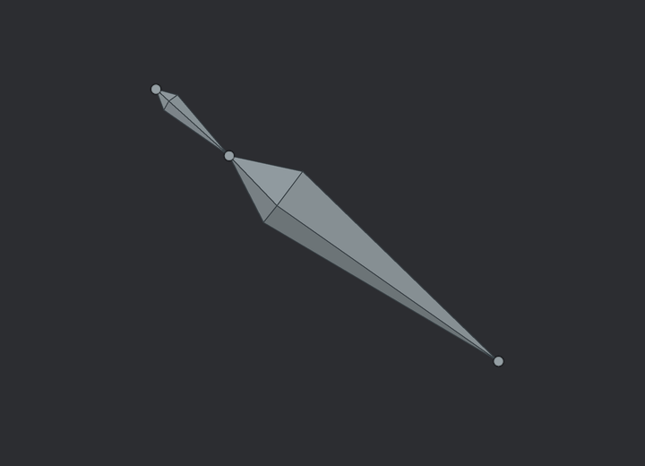

# ArtForge Studio 0.48.3 HOTFIX5

Изменение отображения скелета по образцу, 6 ноября 2026 года.

Кости теперь имеют гранёную объёмную форму: широкая часть около начала и длинное сужение к следующему суставу. Круглые суставы используют тот же серый цвет, что и кости. Выделение и наведение используют общий акцент темы; освещение граней меняет яркость без сдвига оттенка.

Поворот камеры и вращение кости меняют видимые грани. Выбор мышью работает по всей ширине тела, с приоритетом суставов на общих концах. Геометрия обрезается до деления на перспективную координату, поэтому кости рядом с камерой и у края просмотра не создают чрезмерно больших UI-примитивов. Тела выводятся треугольниками и рёбрами с ограниченным числом примитивов независимо от размера на экране и DPI.

Сохраняются создание и продолжение костей, FK/IK, привязка, Undo/Redo, скрытие и блокировка. Архив включает изменения материалов и исправления производительности HOTFIX2–HOTFIX4. Формат проекта и зависимости Cargo не изменены.

## Проверки

| Проверка | Результат |
|---|---|
| Полный набор Rust-тестов workspace | 1292 пройдено, 0 ошибок, 75 ignored |
| Отдельный прогон скелета, авторинга и управления позой | 36 тестов пройдено; входят в полный набор |
| Python-проверки проекта | 62 теста пройдено |
| Windows x64, весь workspace и все цели | `cargo check --workspace --all-targets --locked --target x86_64-pc-windows-msvc` прошёл |
| Статический аудит | 317 Rust, 10 WGSL, 229 связей модулей, 20 JSON-примеров; 0 ошибок |
| Визуальная проверка CPU-превью | Обычный вид, выделение, поворот камеры и светлая тема проверены |

Логи: [Rust](docs/validation/hotfix5-rust-tests.txt), [скелет и поза](docs/validation/hotfix5-focused-tests.txt), [Python](docs/validation/hotfix5-python-tests.txt), [Windows](docs/validation/hotfix5-windows-check.txt), [аудит](docs/validation/hotfix5-source-audit.json).

Rust-тесты выполнены с `profile.test.package.artforge.opt-level=0` и `profile.test.package.poseforge-io.codegen-units=1` для ограничения ресурсов сборки. 75 пропущенных проверок не считаются пройденными: это прежние проверки оборудования/нагрузки и диагностический CPU-замер. Аппаратный рендер, FPS и Windows GUI здесь не запускались. Проверка кода для Windows не создаёт EXE.

## Превью из кода приложения

Изображения построены из реальных примитивов `BoneOverlay::new/draw` тестовой сцены и растеризованы на CPU. Это проверка геометрии, цвета и композиции, а не снимки окна или GPU-рендера; сглаживание на GPU может отличаться.



[Выделение](docs/validation/hotfix5-bones/bones-selected.png) · [Другой ракурс](docs/validation/hotfix5-bones/bones-rotated.png) · [Светлая тема](docs/validation/hotfix5-bones/bones-light.png).

Для воспроизведения задайте переменную окружения `ARTFORGE_QA_BONE_DIR` с каталогом для JSON и выполните:

```text
cargo test -p artforge reference_style_uses_matching_bone_and_joint_colors_and_exports_actual_primitives --locked
python scripts/preview_bone_overlay.py <каталог-JSON> <каталог-PNG>
```

Исходные JSON этих превью также включены в `docs/validation/hotfix5-bones/`. Вспомогательному скрипту нужны NumPy и Pillow.

Архив содержит полный проект с исходниками, без готового EXE. Сборка и запуск на Windows — через `START_WINDOWS.cmd`; требования приведены в `START_HERE_RU.md`.
