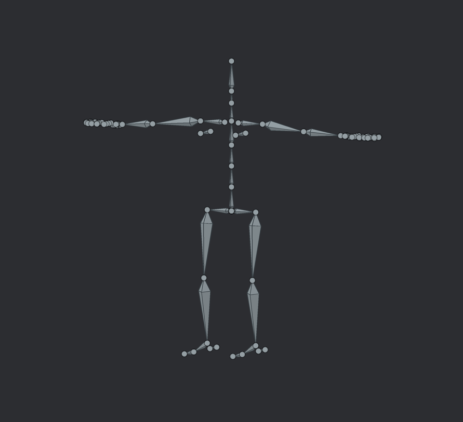

# ArtForge Studio 0.48.3 HOTFIX6

Обновление скелета и его редактирования, 6 ноября 2026 года.

## Что изменилось

- **Раздельный выбор скелета и меша в режиме «Объект».** Щелчок по кости выделяет скелет; щелчок по поверхности выбирает сам меш. Привязанные и прикреплённые меши больше не добавляются в выделение костей. Работают G/R/S, инструмент орбиты и добавление к выделению через Shift/Ctrl. Связи родителей сохраняются.
- **Оформление выбранной кости.** В этапе «Скелет и IK» доступны отдельные цвета кости и сустава, гранёная или прямоугольная кость, круглый или прямоугольный сустав, заливка или контур, отдельные флажки поворота к камере. Цвета редактируются существующей палитрой с HEX, предпросмотром, применением и отменой. Настройки сохраняются в проекте и поддерживают Undo/Redo. Пользовательский цвет остаётся видимым при выделении; выделение обозначается контуром.
- **Панель инструментов упрощена.** Кнопка «Выбрать часть тела» удалена. Выбор частей тела остаётся в этапе «Поза».
- **«Человек · 67 костей» заменяет шаблон на 17 костей.** Добавлены ладони, все пальцы по три фаланги, плечи, дополнительные участки позвоночника, носки и пятки. Последние фаланги имеют собственную длину, видимую в редакторе и учитываемую автовесами. Прежние 17 назначений частей тела сохранены для FK/IK; это число назначений, а не число костей нового скелета.

Существующие сцены, импортированные риги и стартовый манекен автоматически не перестраиваются. Новое оформление и концы костей — необязательные поля схемы 43; старые проекты открываются без них. Зависимости Cargo не менялись. Все изменения HOTFIX2–HOTFIX5 включены.

Как открыть настройки: **выделить скелет → этап «Скелет и IK» → выбрать кость → «Оформление выбранной кости»**. «Следует виду» меняет ориентацию фигуры относительно камеры; видимость управляется глазиком в дереве сцены. Подробности: [руководство по скелету](docs/RIGGING.md).

## Почему 67 костей

Сравнение выполнено по исходникам метаригов Rigify и официальному перечню Unity. Число костей зависит от шаблона и задачи; единого «скелета Blender» нет. Больше костей само по себе не означает лучший результат.

| Вариант | Количество | Назначение |
|---|---:|---|
| Прежний шаблон ArtForge | 17 | Основные части тела без отдельных пальцев |
| Blender Rigify Basic Human | 29 | Базовый метариг тела без пальцев и лица |
| Blender Rigify Human | 159 | Полный метариг, включая кисти и большой лицевой риг |
| Unity HumanBodyBones | 55 именованных позиций | Перечень назначений humanoid; это не требование иметь ровно 55 костей |
| Новый шаблон ArtForge | **67** | **29 костей тела + 8 костей ладоней + 30 фаланг**, состав тела и кистей полного Human без лицевой части |

Для текущего редактора выбран состав из 67 костей: он позволяет позировать пальцы и стопы и не требует большого лицевого рига. Геометрия, пропорции и генератор ArtForge написаны отдельно; код генератора Blender не включён. Это собственный деформирующий шаблон с привычными именами, без генерации управляющих костей, constraints и drivers Rigify. Пропорции нужно подогнать к своему мешу до привязки.

Числа 29 и 159 получены подсчётом вызовов создания костей в исходниках Blender, а 67 — выделением костей тела и кистей полного метарига. Это число костей **метарига**, до генерации системы управления.

Источники проверки:

- [Rigify Basic Human, исходник](https://github.com/blender/blender/blob/main/scripts/addons_core/rigify/metarigs/Basic/basic_human.py), blob SHA `2fc7746f10ddb63976d420366a1185eabb6c8a18`.
- [Rigify Human, исходник](https://github.com/blender/blender/blob/main/scripts/addons_core/rigify/metarigs/human.py), blob SHA `778ea484260ca4a2e490c076c76402e9b0d15c31`.
- [Руководство Blender 3.0: основы работы с метаригами Rigify](https://docs.blender.org/manual/en/3.0/addons/rigging/rigify/basics.html).
- [Unity HumanBodyBones](https://docs.unity.com/en-us/engine/6000.0/script-reference/unityengine/humanbodybones), именованные позиции без служебного `LastBone`.

## Проверки

| Проверка | Результат |
|---|---|
| Полный набор Rust-тестов workspace | **1308 пройдено, 0 ошибок, 75 ignored** |
| Отдельный прогон скелета, выбора, цвета и интерфейса | 71 тест пройден; входят в полный набор |
| Python-проверки | 62 теста пройдено |
| Windows x64, workspace и все цели | `cargo check --workspace --all-targets --locked --target x86_64-pc-windows-msvc` прошёл |
| Статический аудит | 323 Rust, 10 WGSL, 235 связей модулей, 20 JSON-примеров; ошибок нет |
| Визуальная проверка | Проверены CPU-превью человека, кисти, заливки/контура, выделения, ориентации и панели в обеих темах |

Новые регрессии проверяют отдельный выбор костей и мешей мышью с четырьмя инструментами в перспективе/ортографии и DPI 100/200%, отсутствие подсветки костей при выборе меша, сохранение оформлений, отмену/применение цвета одним шагом Undo, заблокированные кости, узкие панели, 67 отдельных тел костей и симметрию кистей, корректность четырёх цепей IK, автовеса у конца длинной кости и продолжение фаланги с восстановлением через Undo. Привязка нового человека проходит проверку отсутствия скачка исходной формы меша.

Логи: [Rust](docs/validation/hotfix6-rust-tests.txt), [целевые проверки](docs/validation/hotfix6-focused-tests.txt), [Python](docs/validation/hotfix6-python-tests.txt), [Windows](docs/validation/hotfix6-windows-check.txt), [аудит](docs/validation/hotfix6-source-audit.json).

Rust-тесты выполнены с `profile.test.package.artforge.opt-level=0`, `profile.test.package.poseforge-core.opt-level=0`, `profile.test.package.poseforge-core.codegen-units=1` и `profile.test.package.poseforge-io.codegen-units=1` для ограничения ресурсов сборки. Эти переопределения применялись только к проверкам; файл настроек проекта не менялся. 75 проверок оборудования/нагрузки и диагностического замера с пометкой `ignored` не считаются пройденными. **Windows GUI, аппаратный рендер и FPS здесь не проверялись.** Проверка Windows-кода не создаёт EXE.

## Превью из приложения

Изображения получены из реальных примитивов `BoneOverlay` и интерфейса, выгруженных тестами и растеризованных на CPU. Это проверка геометрии, цвета и размещения элементов. Это не снимки окна Windows и не аппаратный рендер; для текста используется DejaVu Sans вместо нативного атласа глифов.



[Кисть крупно](docs/previews/hotfix6/bones-human-hand.png) · [Прямоугольник с заливкой](docs/previews/hotfix6/bones-custom-filled.png) · [Контур](docs/previews/hotfix6/bones-custom-outline.png) · [Цвет при выделении](docs/previews/hotfix6/bones-custom-selected.png).

[Тёмная панель настроек](docs/previews/hotfix6/bones-panel-dark.png) · [Светлая панель](docs/previews/hotfix6/bones-panel-light.png) · [Следование камере](docs/previews/hotfix6/bones-view-facing.png) · [Локальная ориентация](docs/previews/hotfix6/bones-local-plane.png).

Для воспроизведения задайте `ARTFORGE_QA_BONE_DIR` и выполните тесты `bones::` и `bone_display_controls_tests::`, затем:

```text
python scripts/preview_bone_overlay.py <каталог-JSON> <каталог-PNG>
```

Скрипту нужны NumPy и Pillow. Исходные JSON включены рядом с PNG.

Архив содержит полный проект с исходниками, без готового EXE. Сборка и запуск на Windows — через `START_WINDOWS.cmd`; требования приведены в `START_HERE_RU.md`.
