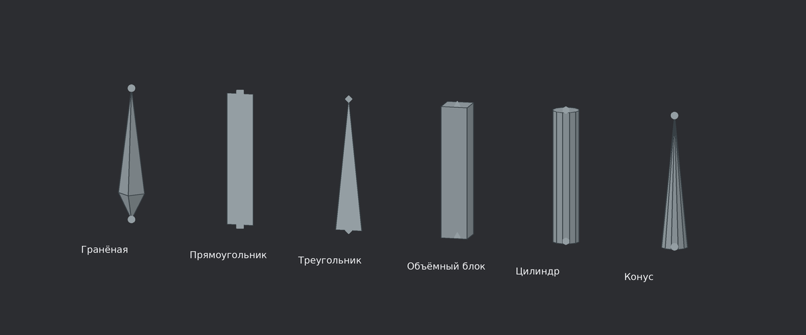

# ArtForge Studio 0.48.3 HOTFIX7

Выпадающие списки форм и отдельный сброс цвета, 6 ноября 2026 года.

В этапе **«Скелет и IK» → «Оформление выбранной кости»** формы теперь выбираются выпадающими списками. Текущий вариант отмечен в списке. Доступны выбор мышью, ↑/↓, Enter и закрытие через Esc; переход по строкам сам по себе не меняет проект. Выбор той же формы сохраняет историю отмены. Смена выбранной кости закрывает устаревший список без применения к другому объекту.

| Элемент | Формы |
|---|---|
| Кость | Гранёная, прямоугольник, треугольник, объёмный блок, цилиндр, конус |
| Сустав | Круг, прямоугольник, ромб, треугольник, шестиугольник |

Прямоугольник и треугольник кости — плоские фигуры вдоль её оси. Блок, цилиндр, конус и гранёная кость имеют объёмные грани. Для всех форм сохранены заливка/контур, отдельные цвета и настройка поворота к камере. Геометрия выбора совпадает с отображаемой; число примитивов ограничено и не зависит от размера кости на экране.

Справа от каждого цветового поля находится **кнопка сброса цвета**. Она возвращает стандартный серый цвет только выбранному элементу — кости или суставу. Второй цвет, формы, заливка и ориентация сохраняются. Действие отменяется одним шагом Undo и поддерживает Redo. При стандартном цвете кнопка видна, но неактивна; повторный сброс не создаёт пустую запись истории. Общая команда «Сбросить оформление» остаётся отдельной.

Настройки сохраняются в `.artforge`. Старые проекты и прежние значения форм открываются как раньше. Схема проекта остаётся 43, новых Cargo-зависимостей нет. Включены все изменения предыдущих HOTFIX, в том числе человек из 67 костей и раздельное выделение меша/скелета.

## Проверки

| Проверка | Результат |
|---|---|
| Полный набор тестов приложения | 684 пройдено, 0 ошибок, 2 ignored |
| Модульные тесты ядра | 31 пройден, 0 ошибок |
| Целевые тесты форм, палитры, списков и выбора | 52 пройдено; входят в набор приложения |
| Python | 62 теста пройдено |
| Windows x64 | Весь workspace и все цели прошли `cargo check --workspace --all-targets --locked --target x86_64-pc-windows-msvc` |
| Статический аудит | 323 Rust, 10 WGSL, 235 связей модулей, 20 JSON-примеров; ошибок нет |

Проверены все 30 сочетаний форм при заполненном и контурном отображении, в перспективе и ортографии: рисование, попадание по граням/контурам, конечность координат и ограниченное число примитивов. Отдельно проверены обрезка у камеры, сохранение всех форм, сброс только одного цвета через реальные кнопки, Undo/Redo, отсутствие пустых записей истории, отмена списка, защита от смены выбранной кости, обе темы, панели шириной 280/336/440 и DPI 100/200%.

Логи: [приложение](docs/validation/hotfix7-app-tests.txt), [ядро](docs/validation/hotfix7-core-tests.txt), [целевые проверки](docs/validation/hotfix7-focused-tests.txt), [Python](docs/validation/hotfix7-python-tests.txt), [Windows](docs/validation/hotfix7-windows-check.txt), [аудит](docs/validation/hotfix7-source-audit.json).

Полный workspace-набор заново не выполнялся; его предыдущий результат сохранён в HOTFIX6. Текущий прогон включает 715 Rust-тестов приложения и ядра. Для тестов использованы `opt-level=0` у `artforge`/`poseforge-core` и `codegen-units=1` у `artforge`/`poseforge-core`/`poseforge-io`; настройки Cargo проекта не изменены. Два `ignored` не считаются пройденными. **Windows GUI, GPU и FPS здесь не проверялись.** Проверка кода Windows не создаёт EXE.

## Превью

Превью получены из настоящих примитивов интерфейса и `BoneOverlay`, выгруженных тестами и растеризованных на CPU. Для текста используется DejaVu Sans. Это проверка геометрии и разметки, не снимки окна Windows и не аппаратный рендер.

[Формы без заливки](docs/previews/hotfix7/bones-shapes-outline.png) · [Панель и сбросы](docs/previews/hotfix7/bones-panel-dark.png) · [Светлая тема](docs/previews/hotfix7/bones-panel-light.png).

[Список форм кости](docs/previews/hotfix7/bones-body-list-dark.png) · [Список форм сустава](docs/previews/hotfix7/bones-joint-list-dark.png).

Архив содержит исходники, без готового EXE. Для сборки на Windows используйте `START_WINDOWS.cmd`; требования — в `START_HERE_RU.md`.
