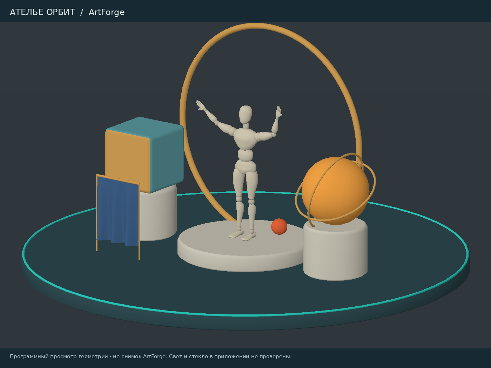

# Ателье орбит

Редактируемая сцена для ArtForge Studio 0.47.9: шарнирный манекен на подиуме, бирюзовый куб с материалом на отдельных полигонах и слоем лака, янтарная стеклянная сфера, золотые кольца и синяя драпировка. Камера, небольшой шар и прожектор привязаны к общей замкнутой кривой; полный оборот занимает 12 секунд.

Откройте [orbit-atelier.artforge](../examples/orbit-atelier.artforge) через «Файл → Открыть». Для материалов и света выберите режим «Рендер». Кнопка воспроизведения запускает движение по орбите. Отдельная камера находится в коллекции «Орбита»; начальный обзор сохранён как свободная камера проекта.

Сцену можно добавить в текущий проект: «Библиотека → Сцены → Ателье орбит». Подготовка идёт в фоне с отменой через Esc и одним шагом Ctrl+Z после завершения. При объединении сохраняются настройки вида и рендера открытого документа. Для готовой композиции с её фоном используйте открытие файла.



Изображение построено из геометрии файла отдельным программным просмотрщиком. Это не снимок ArtForge: нативные материалы, прозрачность, свет, тени и GPU здесь не проверены. Драпировка — статическая сетка со складками без расчёта симуляции ткани.

В сцене 38 узлов, 15 ресурсов мешей, 18 535 вершин, 35 820 треугольников, 17 костей и 3 источника света. Четыре коллекции разделяют манекен, экспозицию, орбиту и основные источники света. Файл не требует внешних текстур или загрузок.

## Исправления

- Изменение света и экспозиции больше не запускает подготовку полигонных частей и геометрии слоёв материала. Параметры обновляются в снимках для растеризации и лучей, старые снимки остаются неизменными.
- Подготовка сцен библиотеки и уменьшение текстур для миниатюр перенесены из потока интерфейса в фоновые задачи.
- Миниатюра света очищает ссылки на объекты и кривые исходной сцены. Перемещение света не создаёт новый вариант той же миниатюры.
- Изменение пикселей текстуры обновляет её миниатюру даже при сохранении адреса буфера в памяти.
- Навигация привязанной камеры учитывает систему координат пути. В режиме «Рендер» пропускается лишнее копирование документа, когда настройки вида не требуют его изменения.

Это исправления по анализу кода. Измерений FPS, времени кадра и отзывчивости нативного окна в этой среде нет.

## Проверка на машине с Rust и графикой

```sh
cargo check --workspace --all-targets --locked
cargo test --workspace --locked
cargo run -p artforge --release --locked -- --validate examples/orbit-atelier.artforge
cargo run -p artforge --release --locked -- examples/orbit-atelier.artforge
```

1. Включите «Рендер», запустите два оборота орбиты и проверьте движение прожектора.
2. Меняйте интенсивность света и экспозицию при видимом кубе с полигонным назначением. Проверьте материалы и Undo.
3. Выберите орбитальную камеру, включите управление камерой в её виде. Проверьте поворот, панорамирование, приближение, отмену жеста и Undo.
4. Добавьте сцену через библиотеку. Проверьте Esc, повторное добавление и один шаг Undo. Сохраните и заново откройте проект, проверьте связи с кривой.
5. Откройте миниатюры материалов и света, включая свет на кривой. Проверьте обновление после правки текстуры и журнал ошибок.

Пять проверок данных: `python3 scripts/test_orbit_atelier.py`. Эти тесты не выполняют Rust-код. Для генерации файла и диагностического изображения используются `scripts/generate_orbit_atelier.py` и `scripts/preview_orbit_atelier.py` (Python, NumPy, Pillow).
