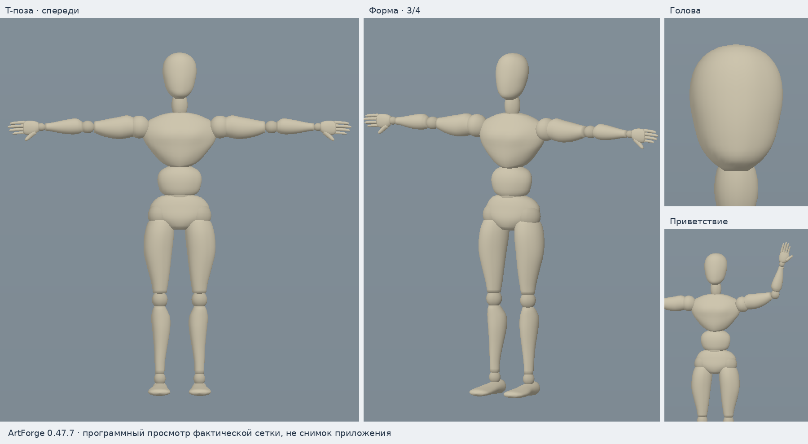
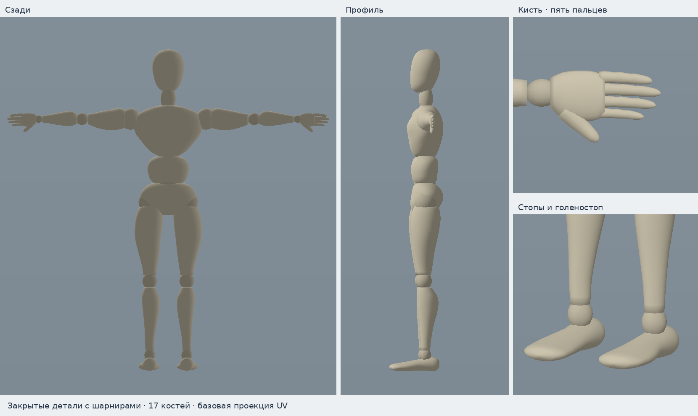

# Шарнирный манекен

Стартовый персонаж заменён по новому пользовательскому образцу: светлый тёплый материал, гладкая голова без лица, выраженный грудной отдел, отдельные живот и таз, округлые суставы, кисти с четырьмя пальцами и большим пальцем, оформленные стопы. Руки разведены в T-позу. Сетка создана самостоятельно; сторонние модели и текстуры не загружались. Задняя поверхность и глубина восстановлены приблизительно по одному изображению.

| Свойство | Значение |
|---|---|
| Система координат | Метры, Y вверх, +Z вперёд |
| Высота / размах рук | Около 2,00 / 2,00 м |
| Геометрия | 13 432 вершины; 12 516 четырёхугольников и 1 672 треугольника |
| Рендер | 26 704 треугольника |
| Редактируемые меши | Корпус и шарниры; голова; кисти и стопы |
| Скелет | 17 костей с сохранёнными идентификаторами |
| Материалы | Три однотонных материала, без внешних текстур |

Модель состоит из 40 намеренно отдельных замкнутых деталей. Шарниры входят в соседние оболочки: это сочленённый манекен, а не единая непрерывная кожа. Каждая деталь жёстко привязана к своей кости, поэтому сгибание сохраняет её объём. Пальцы следуют запястью; отдельного пальцевого и лицевого рига нет. Материалы и части доступны для обычного редактирования в ArtForge.

Новые сцены используют этот манекен. Пример сохранён в `examples/starter-character.artforge`; библиотека сцен также добавляет его в текущую сцену. Существующие пользовательские проекты автоматически не переделываются. Клип «Приветствие» начинается с исходной T-позы и сгибает руку; обратные матрицы привязки пересчитаны под новые положения суставов.

Геометрия, материалы и скелет находятся в `crates/core/assets/starter_character.json`. Генератор `scripts/generate_starter_character.py` работает на стандартной библиотеке Python и обновляет встроенный ресурс и пример. Python не нужен при запуске ArtForge. Имеющиеся UV — базовая проекция с перекрытиями, а не уникальная раскладка для рисования текстур.

Превью получены программным просмотром фактических вершин, нормалей и матриц привязки; это не снимки окна ArtForge. Их воспроизводит `scripts/preview_starter_character.py` с NumPy и Pillow. Семь Python-проверок подтверждают корректные индексы и нормали, замкнутость и ориентацию деталей, веса, исходную позу, согласованность примера и сохранение длин рёбер при позировании. Сборка приложения, Rust-тесты и нативный GPU-рендер в этой среде не запускались.

[Проверки](VALIDATION.md) · [Работа со скелетом](RIGGING.md)
